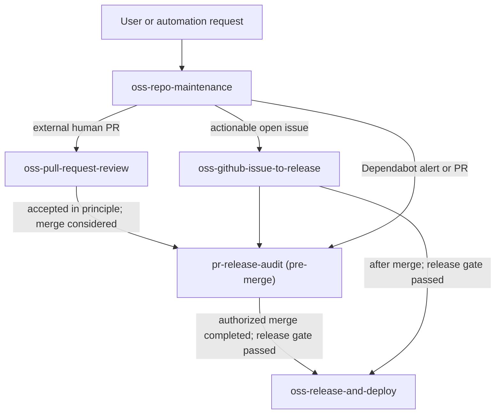

# Agent Skills

A personal, version-controlled library of reusable skills for AI agents. The main direction is to make complete open-source repository maintenance possible through composable skills: an agent finds the next useful task, routes it to the right workflow, checks the work, and stops at the correct decision gates.

This repository also keeps separate workflows, such as technical publishing, and sanitized [MCP server configurations](mcp-configs/) for restoring selected integrations without committing credentials or browser sessions.

## Agent workflows

The terms describe different parts of the system:

- A **workflow** is the outcome and process, such as maintaining an open-source repository.
- An **orchestrator skill** selects the next task and routes it to a specialist skill.
- A **specialist skill** provides focused instructions for one job, such as reviewing a contributor PR or taking an issue through implementation.
- An **agent or runner** executes the workflow. It can be an interactive agent, a scheduled automation, CI, or another compatible system.

The group is called a workflow rather than an agent: the agent is the executor, while the workflow is the coordinated set of skills and decisions. Skills run when invoked; recurring work needs a runner that can start them on a schedule.

### Open-source repository maintenance

The goal is to maintain a repository from one high-level request, such as “find and work through the next repository task.” The orchestrator checks the backlog, leaves owner and maintainer PRs alone, and routes each candidate to a focused skill. The detailed [workflow roadmap](docs/open-source-maintenance-workflows.md) describes how to grow this into a dependable agent-driven maintenance system.

| Skill | Role |
| --- | --- |
| [`oss-repo-maintenance`](skills/oss-repo-maintenance/) | Orchestrates a bounded sweep of external human PRs, actionable open issues, and Dependabot alerts or PRs. |
| [`oss-pull-request-review`](skills/oss-pull-request-review/) | Evaluates a community contribution's need, product fit, technical quality, and consistency across related languages, tools, and versions. |
| [`oss-github-issue-to-release`](skills/oss-github-issue-to-release/) | Takes an actionable issue through validation, planning, implementation, tests, documentation, PR, and separately authorized merge or release. |
| [`pr-release-audit`](skills/pr-release-audit/) | Checks pre-merge readiness, including current vendor contracts, documentation and site parity, release metadata, and contributor credit. |
| [`oss-release-and-deploy`](skills/oss-release-and-deploy/) | Coordinates an authorized post-merge release and deployment using the repository's own release instructions, then verifies each public surface. |



The current skills support agent-run, bounded work. A continuously running or scheduled service is not part of this repository yet; the roadmap treats runner selection, permission scope, checkpointing, and scheduling as later implementation work.

### Publishing and content

[`devto-publish-expert`](skills/devto-publish-expert/) researches and writes specialist DEV Community articles, selects exactly four relevant tags, validates technical quality, and uses a draft-first publishing workflow.

Key guarantees:

- quality and evidence before growth tactics;
- exactly four relevant DEV.to tags;
- no fabricated experience, benchmarks, or claims;
- deterministic Markdown validation;
- drafts by default and explicit approval before publication;
- correct handling of DEV temporary draft URLs.

## Keep global skills in sync

Use this repository as the canonical source for your personal skills. Clone it once on each computer, pull before working, and link its skill folders into your agent's global skill directory. Editing a linked skill edits the tracked source in this clone.

On Windows PowerShell, the default links skills into the shared user-level `.agents/skills` directory used by Codex and compatible agents. Use `-Agent all` to also link Claude Code:

```powershell
New-Item -ItemType Directory -Force "$HOME\Developer" | Out-Null
git clone https://github.com/paladini/agent-skills.git "$HOME\Developer\agent-skills"
Set-Location "$HOME\Developer\agent-skills"
git pull
.\scripts\link-global-skills.ps1 -Agent codex
```

On macOS or Linux (use the PowerShell script on Windows):

```bash
mkdir -p "$HOME/Developer"
git clone https://github.com/paladini/agent-skills.git "$HOME/Developer/agent-skills"
cd "$HOME/Developer/agent-skills"
git pull
./scripts/link-global-skills.sh --agent codex
```

Codex also scans the legacy `$CODEX_HOME/skills` location. Use `.agents/skills` as the shared source here; the installer preserves a same-named legacy skill and reports the conflict instead of creating a duplicate. See [Codex skill discovery roots](https://github.com/openai/codex/blob/main/codex-rs/ext/skills/src/host_roots.rs#L914-L935). Choose `all` to link the shared directory and Claude Code, or pass one or more custom skill roots with `-TargetRoot` (PowerShell) or `--target-root` (shell). Run the link command after adding a skill. When renaming or removing one, remove its old link manually after confirming it points into this repository; the installer does not prune links. To link just one skill, use `-SkillName <name>` or `--skill <name>`. Existing skill directories are never overwritten; resolve a reported conflict manually after inspecting and preserving its contents.

After editing a skill, inspect `git diff`, then commit and push the change. On another computer, run `git pull`; existing links immediately use the updated files. Git does not upload local edits automatically, so push each change you want backed up on GitHub. Do not commit credentials, private prompts, or personal data.

## Validate

Validate skill structure with the Agent Skills validator, run bundled tests, and check the global link scripts:

```bash
python path/to/skill-creator/scripts/quick_validate.py skills/devto-publish-expert
python -m unittest discover -s skills/devto-publish-expert/scripts -p "test_*.py"
python scripts/validate_mcp_configs.py
python path/to/skill-creator/scripts/quick_validate.py skills/oss-github-issue-to-release
python path/to/skill-creator/scripts/quick_validate.py skills/oss-pull-request-review
python path/to/skill-creator/scripts/quick_validate.py skills/oss-repo-maintenance
python path/to/skill-creator/scripts/quick_validate.py skills/oss-release-and-deploy
python -m unittest discover -s scripts -p "test_link_global_skills.py"
```

## Contributing

Keep skills concise, evidence-led, safe around external side effects, and compatible with progressive disclosure. See [CONTRIBUTING.md](CONTRIBUTING.md).

## License

MIT license - see [LICENSE](LICENSE).
